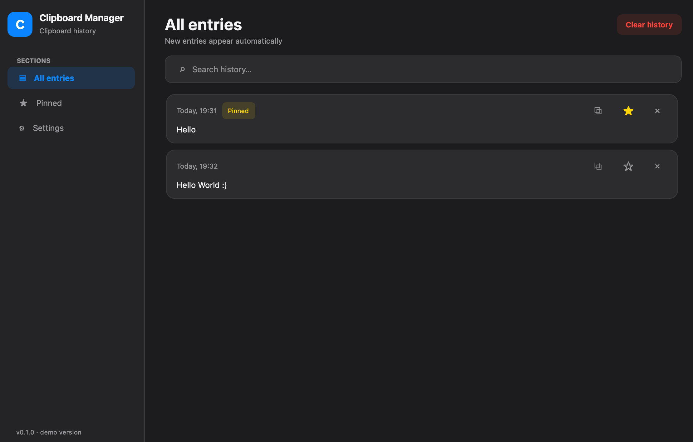
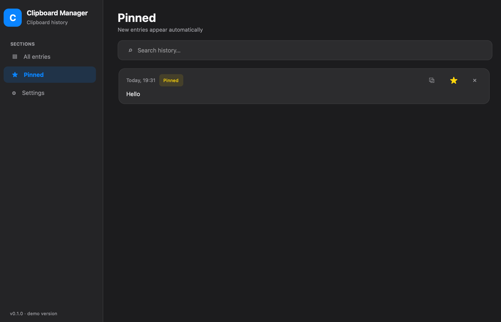
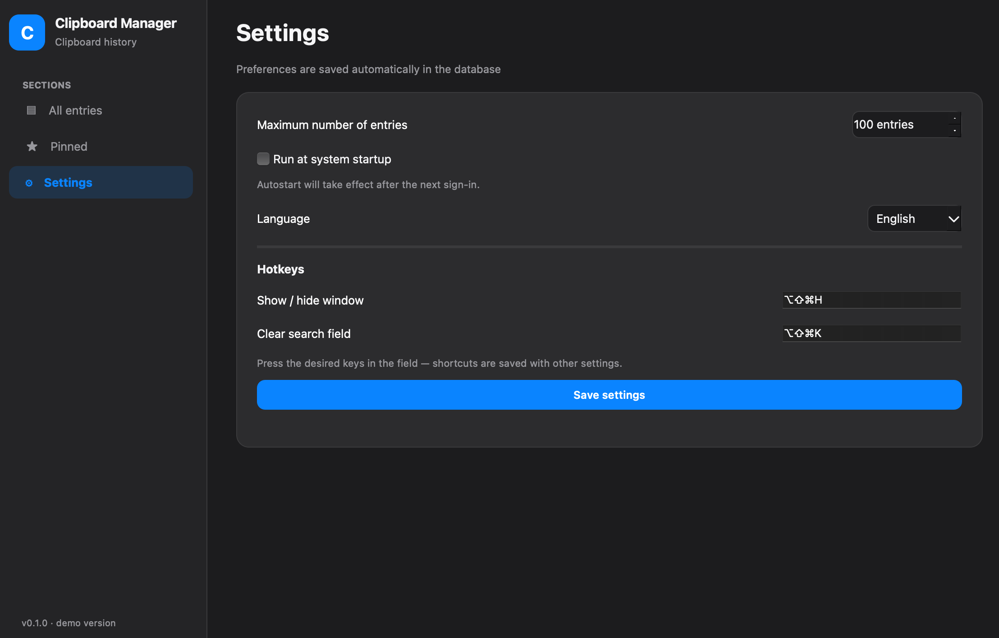

# Clipboard Manager

A small desktop clipboard history manager built with **PySide6**. It watches the
system clipboard, keeps a searchable text history in SQLite, and lives in the
system tray when the window is closed.

**Supported operating systems:** macOS and Windows  
**Python:** 3.10 or newer

> The interface is available in Ukrainian and English. Ukrainian is the default;
> the language can be changed at any time in **Settings** without restarting.

## Features

- Automatic text-clipboard tracking via `QClipboard.dataChanged` — no restart needed.
- Empty and duplicate entries are ignored; copying an entry back does not create a duplicate.
- Persistent SQLite history, restored on the next launch.
- Configurable history limit (100 by default). The oldest **unpinned** entries are
  removed first; pinned entries are never removed automatically.
- Pin, delete and copy back individual entries; clear the whole history after confirmation.
- Separate **All entries** and **Pinned** sections.
- Instant case-insensitive search (Latin and Cyrillic) with an empty-state message.
- Dark, macOS-inspired UI with a sidebar, hover effects and the system UI font.
- Configurable global hotkeys:
  - show/hide the window (registered system-wide);
  - clear the search field (application-wide `QShortcut`).
- Hotkey conflict checks: both combinations must be set, contain a modifier and differ.
- Optional autostart: a LaunchAgent on macOS, a Run registry value on Windows.
- Live interface translation (Ukrainian / English) with English as the fallback.
- System tray icon: closing the window hides the app to the tray, clicking the icon
  reopens it, and the context menu offers **Open app**, **Settings** and **Quit**.
- Single-instance behaviour: a second launch asks the running instance to show its window.
- Platform differences are isolated in `app/autostart.py`, `app/hotkeys.py` and `app/tray.py`.

## Screenshots

Screenshot placeholders are reserved in `docs/screenshots/`. Add the images at
these paths when they are ready; the markdown links below can then be uncommented.

| View | Placeholder file |
| --- | --- |
| Main window — all entries | `docs/screenshots/01-main-window.png` |
| Pinned entries and search | `docs/screenshots/02-pinned-search.png` |
| Settings | `docs/screenshots/03-settings.png` |
| System tray context menu | `docs/screenshots/04-tray-menu.png` |

<!--




-->

## Installation from source

You need Python 3.10+ with `venv`. From the repository root:

### macOS / Linux shell

```bash
python3 -m venv .venv
source .venv/bin/activate
python -m pip install -r requirements.txt
python run.py
```

### Windows (PowerShell)

```powershell
py -3 -m venv .venv
.\.venv\Scripts\Activate.ps1
python -m pip install -r requirements.txt
python run.py
```

Only PySide6 is required at runtime. `sqlite3` and the standard library modules
are used from Python itself; no external database server is needed.

For building standalone executables, install the development dependencies and
follow the OS-specific guide:

```bash
python -m pip install -r requirements-dev.txt
```

- **macOS** → [docs/build-macos.md](docs/build-macos.md):
  `bash scripts/build_macos.sh` → `dist/macos/Clipboard Manager.app`
- **Windows** → [docs/build-windows.md](docs/build-windows.md):
  `scripts\build_windows.bat` → `dist\windows\Clipboard Manager\Clipboard Manager.exe`

Both guides use the shared driver `scripts/build_app.py`, which generates the
platform icon, collects the Qt/SQLite/hotkey dependencies and verifies the
output. Builds must be made on the target OS — Windows `.exe` files are not
cross-compiled on macOS. Both `build/` and `dist/` are ignored by Git.

## Continuous integration

`.github/workflows/build.yml` builds both platforms automatically:

- every `push` to any branch, and
- manually via **Actions → Build desktop apps → Run workflow**.

Two separate jobs use `macos-latest` and `windows-latest` runners, so each
platform is built natively. Both jobs install `requirements-dev.txt`, run the
shared PyInstaller driver, verify the output and upload it as a GitHub Actions
Artifact:

- `clipboard-manager-macos-app` — the `Clipboard Manager.app` bundle;
- `clipboard-manager-windows-exe` — the `dist/windows` folder containing
  `Clipboard Manager\Clipboard Manager.exe`.

Open the workflow run in the **Actions** tab and download the artifact from the
*Artifacts* section. No GitHub Release is created automatically.

## Quick start

1. Launch the app: `python run.py`.
2. Copy any text — it appears at the top of **All entries**.
3. Use the search field to filter the history, or switch to **Pinned**.
4. On a card, use ⧉ to copy back, ★ / ☆ to pin, ✕ to delete.
5. Open **Settings** to change the history limit, autostart, language or hotkeys.
6. Close the window: the app stays in the tray. Click the tray icon to reopen it.
   Right-click (Windows) or click (macOS) the tray icon and choose **Quit** to exit fully.

Default hotkeys: `Ctrl+Shift+Alt+H` — show/hide the window;
`Ctrl+Shift+Alt+K` — clear the search field. On macOS Qt maps portable `Ctrl`
to Command (⌘) and `Meta` to the physical Control key, so the same saved strings
produce platform-native combinations. macOS may ask for keyboard-input permission
before global hotkeys work.

## Configuration and data storage

`app/storage/history_repository.py` creates `history.sqlite3` in the user data
directory determined by `QStandardPaths` — never inside the project folder:

- macOS: `~/Library/Application Support/ClipboardManager/Clipboard Manager/history.sqlite3`
- Windows: `%APPDATA%\ClipboardManager\Clipboard Manager\history.sqlite3`

The database has two tables:

- `entries`: `id`, `text`, `created_at` (ISO 8601), `pinned` (0/1);
- `settings`: key/value rows for `max_history`, `autostart`, `toggle_hotkey`,
  `clear_hotkey` and `language`.

If SQLite is unavailable, the error is logged and the app keeps working in memory.
Autostart writes `~/Library/LaunchAgents/com.clipboardmanager.plist` on macOS and
`HKCU\Software\Microsoft\Windows\CurrentVersion\Run` on Windows. Changes take
effect after the next sign-in.

## Translations

All interface strings live in `app/i18n.py`:

- `TRANSLATIONS` holds the Ukrainian and English dictionaries;
- `LANGUAGE_NAMES` holds the names shown in the Settings combo box;
- `tr(key, **kwargs)` returns the current language string, falling back to English
  and then to the key itself.

`I18n.set_language()` emits `language_changed`; widgets implement `retranslate()`
so the whole UI, including tray menu items and status messages, updates instantly.
Text copied by the user is never translated. To add a language, add a dictionary
to `TRANSLATIONS` and its name to `LANGUAGE_NAMES` — no other files need changes.

## System tray

`app/tray.py` creates exactly one `QSystemTrayIcon` for the lifetime of the process.
The icon is drawn with `QPainter`: a monochrome template image for the macOS menu
bar and a coloured icon for Windows. Closing the window calls `hide()` rather than
quitting, so clipboard monitoring and global hotkeys keep running. **Quit** calls
`quit_app()`, which unregisters hotkeys, stops the monitor, hides the icon and
quits `QApplication`. If no tray is available, closing the window exits normally.
`app/main.py` disables `quitOnLastWindowClosed` and uses `QLocalServer` so a second
launch only asks the first instance to show its window.

## Project structure

```text
ClipboardManager/
├── .github/
│   └── workflows/
│       └── build.yml              # push/manual builds for macOS and Windows
├── run.py                         # application entry point
├── requirements.txt               # runtime dependency: PySide6
├── requirements-dev.txt           # + PyInstaller for standalone builds
├── README.md
├── .gitignore
├── app/
│   ├── __init__.py
│   ├── main.py                    # QApplication, single-instance guard, event loop
│   ├── theme.py                   # palette, font and the single QSS stylesheet
│   ├── clipboard_monitor.py       # QClipboard subscription, duplicate filtering
│   ├── autostart.py               # LaunchAgent (macOS) / Registry Run (Windows)
│   ├── hotkeys.py                 # parser, HotkeyManager, Carbon/Win32 backends
│   ├── i18n.py                    # translations, tr(), language-change signal
│   ├── tray.py                    # tray icon and context menu
│   ├── models/
│   │   ├── __init__.py
│   │   ├── app_settings.py        # settings dataclass + SQLite parsing
│   │   ├── clipboard_entry.py     # entry dataclass + timestamp formatting
│   │   └── clipboard_store.py     # in-memory operations + change signal
│   ├── storage/
│   │   ├── __init__.py
│   │   └── history_repository.py  # SQLite schema, CRUD, error handling
│   └── ui/
│       ├── __init__.py
│       ├── main_window.py         # window composition, tray and actions
│       ├── sidebar.py             # navigation
│       ├── entries_view.py        # header, search, card list, empty state
│       ├── clipboard_card.py      # entry card with hover and pinning
│       ├── search_field.py        # search input with clear button
│       └── settings_view.py       # limit, autostart, language, hotkeys
├── docs/
│   ├── build-macos.md             # macOS .app build guide
│   ├── build-windows.md           # Windows .exe build guide
│   └── screenshots/               # placeholder directory for README images
└── scripts/
    ├── build_app.py               # shared PyInstaller driver + icon generation
    ├── build_macos.sh             # macOS wrapper
    └── build_windows.bat          # Windows wrapper
```

## How clipboard tracking works

1. `ClipboardMonitor.start()` stores the current clipboard text as the initial
   state and subscribes to `QClipboard.dataChanged`.
2. A `QTimer(interval=0)` reads the clipboard on the next event-loop tick, giving
   Qt time to prepare the data on both platforms.
3. Empty text and text equal to the previous value are ignored.
4. `ClipboardStore.add_entry()` creates an entry, saves it to SQLite and applies
   the configured limit if needed.
5. The `entries_changed` signal immediately rebuilds the card list in the UI.

## License

No license file is included yet. Add one before publishing if you want to define
reuse terms explicitly.
